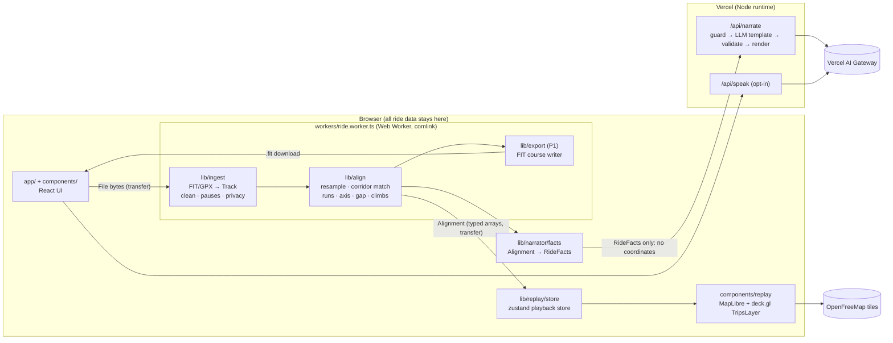

# CloneRider architecture

> **Authorship.** This document and the *contract* files it lists (types, schemas, interfaces, constants, config, route placeholders) were written with Claude Code on Nov 16 2026. They hold **no algorithm or UI logic**: every function body that does real work is implemented in Kiro from the specs. See `docs/KIRO_USAGE.md`.

## 1. System at a glance



**Three hard boundaries:**
1. **Privacy boundary:** ride files, coordinates and file names never leave the browser. The only payload that crosses the network is `RideFacts` (numbers + labels, zod-validated, ≤ 16 kB) and narration text for `/api/speak`.
2. **Thread boundary:** parsing and alignment run in one module worker behind the `RideWorkerApi` contract (`workers/rideWorkerApi.ts`). The main thread only renders.
3. **Purity boundary:** `lib/` is pure TypeScript with no React, DOM, `window` or `document`. The same code runs in the worker, in Vitest/fast-check, and in the dev-only `ghost-lab` MCP server.

## 2. Data flow, step by step

| # | Step | Where | In → Out | Contract |
|---|---|---|---|---|
| 1 | Pick files / "Summon the sample ghosts" | `components/upload/*` | `File[]` or `public/samples/archive/*.gpx` → `ArrayBuffer[]` | — |
| 2 | Detect format | `lib/ingest/detect.ts` | bytes + name → `'fit' \| 'gpx'` | `SourceFormat` |
| 3 | Decode | `lib/ingest/fit.ts`, `gpx.ts` | bytes → `RawRecords` | `FitParser`, `DomParserCtor` |
| 4 | Clean, pauses, distance | `lib/ingest/normalize.ts`, `pauses.ts`, `distance.ts` | `RawRecords` → `Track` | `Track` |
| 5 | Privacy trim | `lib/ingest/privacy.ts` | `Track` + `PrivacyZone[]` → `Track` (with `segStart` breaks) | `PrivacyZone` |
| 6 | Resample + headings | `lib/geo/*` | `Track` → `Resampled` | `Resampled` |
| 7 | Overlap discovery | `lib/align/corridor.ts`, `runs.ts` | present + ghost → `OverlapRun[]` | `MatchResult`, `OverlapRun` |
| 8 | Align chosen run | `lib/align/routeAxis.ts`, `gap.ts`, `climbs.ts` | run → `Alignment` + `Climb[]` | `Alignment`, `Climb` |
| 9 | Replay | `lib/replay/*`, `components/replay/*` | `Alignment` → frames | `ReplayState` |
| 10 | Facts | `lib/narrator/facts.ts` | `Alignment` + `Climb[]` → `RideFacts` | `RideFacts` |
| 11 | Narrate | `app/api/narrate` | `RideFacts` → `NarrationScript` | `NarrateRequest`, `NarrateResponse` |
| 12 | Voice | browser `speechSynthesis` (default) or `app/api/speak` | text → audio | `SpeakRequest` |
| 13 | Take the ghost home (P1) | `lib/export/fitCourse.ts` | `Alignment` → `.fit` bytes | `FitCourseWriter` |

## 3. Modules and ownership

| Module | Owns | Contract file (written) | Implementation (Kiro spec) |
|---|---|---|---|
| `lib/brand.ts` | product name, storage prefix | ✅ complete | — |
| `lib/result.ts` | `Result<T, E>` helpers | ✅ complete | — |
| `lib/ingest/` | file → `Track` | `types.ts` | `ride-ingest` |
| `lib/geo/` | ruler, resample, headings | `types.ts` | `ghost-alignment` |
| `lib/align/` | overlap, axis, gap, climbs | `types.ts`, `constants.ts` | `ghost-alignment` |
| `lib/export/` (P1) | FIT course encode | `types.ts` | `ghost-alignment` (P1 tasks) |
| `lib/narrator/` | facts, slots, validator, render, prompt | `schema.ts` | `ghost-narrator` |
| `lib/replay/` | clock, format, camera, layers, store | `types.ts` | `replay-viewer` |
| `lib/api/` | HTTP payload schemas | `contracts.ts` | `ghost-narrator` |
| `workers/` | the comlink API | `rideWorkerApi.ts` | `ride-ingest` + `ghost-alignment` |
| `app/` | routes and pages | placeholders | `haunted-ui`, `replay-viewer` |
| `components/` | React UI | — (empty) | `haunted-ui`, `replay-viewer` |
| `tools/ghost-lab-mcp/` | dev MCP over `lib/` | — | `ghost-alignment` task 0 |

Dependency rule (enforced by review, ESLint rule later): `app → components → lib`, `workers → lib`, `tools → lib`. **`lib` imports nothing from the others.**

## 4. Key decisions

| Decision | Why | Alternative rejected |
|---|---|---|
| All parsing/alignment client-side in a worker | Privacy pitch ("files never leave your device"), zero server cost, works offline | Server-side parsing: would need storage, privacy policy, uploads |
| Struct-of-typed-arrays (`Float64Array`) | 10k-point tracks, transferable to/from the worker without copying | Arrays of point objects: GC pressure, ~5× slower |
| `cheap-ruler` + `flatbush` in hot paths, Turf only in tests | Speed budgets (align 10k×10k ≤ 150 ms); Turf becomes the test oracle | Turf everywhere: too slow in loops |
| Corridor matching on the present ride's polyline | Finds *partial* overlaps between different routes; linear-ish with a spatial index | DTW / Fréchet: quadratic, assumes the whole ride overlaps |
| Narrator fills **slots** in a template; the model never writes numbers or direction words | Wrong numbers become impossible, and property tests can prove it | Free-text generation + post-hoc fact check: can still leak errors |
| Browser voice by default, neural TTS opt-in | No cost per judge visit; works without Gateway speech access | Neural by default: cost + availability risk |
| deck.gl overlaid (`interleaved: false`), not interleaved | Interleaved mode crashes on MapLibre 6.18 + deck.gl 9.4.1 (spike S2); trails above the map lose nothing | Interleaved: broken today |
| Scoped `@deck.gl/*` packages, not the `deck.gl` umbrella | The umbrella pulls ArcGIS/Vaadin UI kits and a telemetry postinstall | `deck.gl` meta-package |
| No database, no auth | Nothing to store server-side; fewer moving parts for a solo 3-week build | Accounts / saved rides: P2 at most, in IndexedDB |

## 5. Worker contract

`workers/rideWorkerApi.ts` defines `RideWorkerApi`, the only surface the UI may call:

- `ingest(files, zones)` → `IngestedRide[]` (per-file `Result`, so one bad file doesn't sink the batch)
- `findOverlaps(presentId, ghostIds)` → `OverlapSummary[]` ranked by shared length
- `align(presentId, ghostId, runIndex, clockMode)` → `{ alignment, climbs }`
- `searchArchive(presentId, onProgress)` (P1)
- `exportCourse(presentId, ghostId, runIndex)` (P1) → `Uint8Array`
- `dispose()`

Tracks stay **inside the worker** after ingest (keyed by `Track.id`); only summaries and the final `Alignment` cross back, as transferables. The UI never holds raw tracks.

## 6. API contracts (`lib/api/contracts.ts`)

| Route | Method | Request | Response | Guards |
|---|---|---|---|---|
| `/api/narrate` | POST | `NarrateRequest` = `{ facts: RideFacts, persona? }` | `NarrateResponse` = `{ script, source: 'llm' \| 'template' }` | zod, 16 kB cap, `NARRATOR_ENABLED` kill switch, best-effort rate limit, Gateway spend limit |
| `/api/speak` | POST | `SpeakRequest` = `{ text ≤ 1200 chars, voice? }` | `audio/mpeg` | same, plus opt-in toggle in UI |

Both routes run on the default Node.js runtime (no `runtime` export: Next 16 rejects it with `cacheComponents` on) and currently return **501** until the `ghost-narrator` spec implements them.

## 7. State and rendering

- One zustand store (`lib/replay/store.ts`) holds `ReplayState`. The animation clock advances in a single `requestAnimationFrame` loop that writes to deck.gl layer props directly; React re-renders the HUD at ≤ 10 Hz via a throttled selector.
- The map is loaded with `next/dynamic(..., { ssr: false })`. deck.gl draws on its own canvas above MapLibre (`MapboxOverlay({ interleaved: false })`: interleaved mode crashes on MapLibre 6, spike S2), and MapLibre's own worker is served from `public/vendor/` via `setWorkerUrl` (`docs/SPIKES.md`). The basemap style is committed (`public/map/haunted-style.json`), so a tile outage degrades to a plain dark background rather than breaking the replay.

## 8. Testing architecture

| Layer | Tool | Lives in | Runs by |
|---|---|---|---|
| Contracts (schemas parse, constants sane) | Vitest | `tests/contracts.test.ts` | `pnpm test` |
| Pure units | Vitest | `lib/**/*.test.ts` (colocated) | `pnpm test`, hooks |
| Properties (see each spec's Correctness Properties) | fast-check + `@fast-check/vitest` | `lib/**/*.pbt.test.ts`, generators in `tests/arbitraries/` | `pnpm test:pbt`, `geo-pbt-guard` hook |
| Real-data checks | Vitest on `public/samples/archive/` | `tests/real/*.test.ts` | `pnpm test` |
| Worker smoke + judge path | Playwright | `tests/e2e/` | `pnpm e2e` |
| Narration grounding | `scripts/narrator-eval.ts` | — | `pnpm narrator:eval`, hook |

## 9. Deployment

- Vercel project from the GitHub repo; Node runtime (Fluid Compute) for both API routes.
- Env vars: see `.env.example`. AI Gateway auth via OIDC on Vercel, `AI_GATEWAY_API_KEY` locally.
- Set a **Gateway spend limit** before the demo goes public; it is the real cost guard.
- The app must stay up through the judging period (to Jan 29 2027).

## 10. Directory map (current state)

```
app/                 layout, landing placeholder, /ride placeholder, /api/narrate + /api/speak (501)
components/          (empty; haunted-ui + replay-viewer specs)
lib/
  brand.ts           ✅
  result.ts          ✅
  ingest/types.ts    contract
  geo/types.ts       contract
  align/types.ts     contract
  align/constants.ts contract (values from geo-math steering)
  export/types.ts    contract (P1)
  narrator/schema.ts contract (zod)
  replay/types.ts    contract
  api/contracts.ts   contract (zod)
workers/
  rideWorkerApi.ts   contract
tests/
  contracts.test.ts  checks the contracts load and agree with steering
  arbitraries/eps.ts float tolerance helpers
public/samples/      scrubbed sample rides
```
