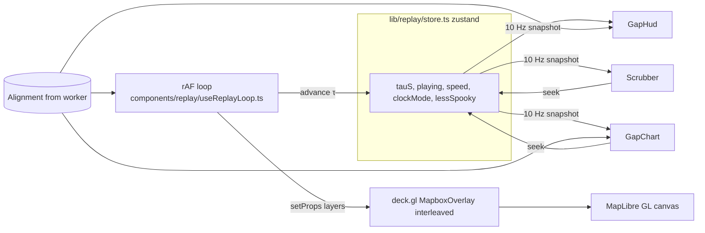

# Design Document: Replay Viewer (SEED, Claude Code draft: reference only, not fed to Kiro)

> **Seed status:** Claude Code draft (v0.1, lightly patched in v0.2). Per PRD Decisions log #2, the canonical `replay-viewer` spec is generated by Kiro from PRD §7.3 **without** this seed. This file is kept only for the "seed vs Kiro output" comparison. PRD §7.3 supersedes it (chase camera, gap ribbon, lead-change beats, committed style, per-segment trails, clip export moved to P2).

## Overview

The Replay Viewer is a client-only React surface on `/ride`. A single `requestAnimationFrame` loop owns time. Each frame it reads the Playback_Clock store, asks the precomputed `Alignment` for the riders' positions with O(log n) binary search, and pushes new deck.gl layer props to an interleaved `MapboxOverlay` on MapLibre. React components (HUD, Scrubber, Chart) subscribe to a **throttled** (10 Hz) snapshot of the store, so React never re-renders at 60 fps.

## Architecture



## Components and Interfaces

| Component / module | Responsibility |
|---|---|
| `lib/replay/clock.ts` | Pure: `advance(state, dtMs) → state`, `seekFraction(f, tauMax)`, `fractionOf(tau, tauMax)`, with clamping and `finished` detection |
| `lib/replay/format.ts` | Pure: `formatGap(gapS) → { word: 'AHEAD'\|'BEHIND'\|'LEVEL', arrow, text }` (sign flip happens here only), `formatDuration(s)`, `formatKm(m)` |
| `lib/replay/store.ts` | zustand store + `useThrottledReplay(selector, hz = 10)` |
| `lib/replay/layers.ts` | Pure builders: `buildTripsData(alignment, mode)` returns `{ path, timestamps }` for ghost/present; `ghostLayers(data, colour, tau)` returns `[glow, core]` |
| `lib/replay/simplify.ts` | Display-only polyline simplification (Douglas–Peucker, tolerance ~2 m) |
| `components/replay/ReplayMap.tsx` | MapLibre init (committed recoloured style, attribution, overlay, fitBounds |
| `components/replay/useReplayLoop.ts` | The single rAF loop; cancels when the component unmounts or the tab is hidden |
| `components/replay/GapHud.tsx` | Word + arrow + mono gap, distance gap, remaining; lead-change flicker |
| `components/replay/Scrubber.tsx` | Accessible range input + speed buttons + play/pause |
| `components/replay/GapChart.tsx` | SVG chart: gap line, zero axis, elevation area, climb bands, rider markers, click-to-seek |
| `components/replay/RunPicker.tsx` | Lists runs; empty state |
| `components/replay/SpookSettings.tsx` | "Less spooky", sound, clock mode (localStorage) |
| `components/ui/FogVignette.tsx` | SVG `feTurbulence` overlay; static under reduced motion |
| `lib/replay/camera.ts` | Pure chase-camera math: target, bearing easing, zoom for a 30% gap span (added v0.2) |
| `components/replay/GapRibbon.tsx` | Gap ribbon layer + label (added v0.2) |

**TripsLayer data:**
- `getPath` uses the display-simplified axis-snapped coordinates, one path per segment (never across a Segment_Break).
- `getTimestamps` uses re-zeroed seconds for the active Clock_Mode.
- `currentTime = τ`.
- `trailLength = 90` s of replay time, so the ghost trail fades behind the head.

## Data Models

```ts
interface ReplayState {
  tauS: number; tauMaxS: number; playing: boolean; speed: 1 | 4 | 16 | 64;
  clockMode: 'moving' | 'elapsed'; lessSpooky: boolean; soundOn: boolean;
  selectedRunIndex: number; finished: boolean;
}
```
- Spook_Settings persist under the localStorage key `${STORAGE_PREFIX}.settings.v1`, zod-validated on read. Reads and writes are wrapped so that a storage failure falls back to defaults (and is logged in dev).

## Correctness Properties

*A property is a characteristic or behavior that should hold true across all valid executions of a system — essentially, a formal statement about what the system should do. Properties serve as the bridge between human-readable specifications and machine-verifiable correctness guarantees.*

### Property 1: Clock bounded and monotone while playing

*For any* starting state and any sequence of positive frame deltas, while `playing` is true τ should be non-decreasing and should stay within [0, τ_max]. When τ reaches τ_max, `playing` should become false and `finished` true.

**Validates: Requirements 3.1, 3.5**

### Property 2: Scrubber mapping round-trip

*For any* τ_max > 0 and f ∈ [0, 1], `fractionOf(seekFraction(f, τ_max), τ_max)` should equal f within 1e-9. Inputs outside [0, 1] should clamp.

**Validates: Requirements 3.2, 3.3**

### Property 3: Gap formatting is sign-consistent

*For any* finite gapS:
- `formatGap` returns `BEHIND` with `▼` iff gapS ≥ 0.5, `AHEAD` with `▲` iff gapS ≤ −0.5, and `LEVEL` otherwise
- the displayed m:ss parses back to |gapS| rounded to the nearest second

**Validates: Requirements 4.1, 4.3**

### Property 4: Trips data matches the alignment

*For any* Alignment, `buildTripsData` should produce timestamp arrays that are non-decreasing and equal in length to the path arrays, and every ghost path vertex should lie on the Route_Axis (< 0.01 m).

**Validates: Requirements 2.3**

## Error Handling

- **WebGL unavailable:** show a static SVG rendering of the shared stretch and the Gap_Chart, with the message "Your browser can't summon WebGL ghosts; here's the chart instead."
- **Tile load failure:** keep the trails over a plain `--void` background and keep the attribution.
- **Tab hidden:** pause the rAF loop, and resume on `visibilitychange`.
- **Storage failure:** fall back to the default settings.

## Testing Strategy

### Unit Tests
- `format.test.ts`: boundary values (0.49, 0.5, −0.5, 59.5 s → 1:00).
- `GapHud.test.tsx` (React Testing Library): renders the word and arrow for both states; no flicker class under reduced motion (4.4, 7.1).
- `Scrubber.test.tsx`: keyboard bindings and `aria-valuetext` (3.4).
- e2e `tests/e2e/judge-path.spec.ts` (Playwright): `/ride?sample=1` auto-plays within 20 s; attribution visible at 375×812; no horizontal scroll (1.2, 8.1, 9.1).
- Visual QA through the Playwright MCP against `ui-haunt.md` (screenshots saved to `docs/kiro-evidence/`).

### Property-Based Tests
fast-check via `@fast-check/vitest`, 100 runs.
- Tag: Feature: replay-viewer, Property 1: Clock bounded and monotone while playing
- Tag: Feature: replay-viewer, Property 2: Scrubber mapping round-trip
- Tag: Feature: replay-viewer, Property 3: Gap formatting is sign-consistent
- Tag: Feature: replay-viewer, Property 4: Trips data matches the alignment
