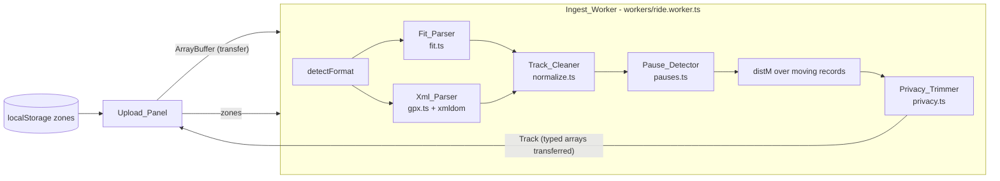

# Design Document: Ride Ingest (SEED, Claude Code draft v0.2: reference input, not Kiro output)

## Overview

Ride Ingest is a pure-TypeScript pipeline in `lib/ingest/`, exposed to the UI through a comlink module Web Worker (`workers/ride.worker.ts`). Each step is a pure function over typed arrays, so it runs in Vitest, in the worker and in the dev-only `ghost-lab` MCP server. There is **one XML code path**: `@xmldom/xmldom`'s `DOMParser` is injected in the worker and in tests (workers have no native `DOMParser`).

```
File ─► arrayBuffer ─► (transfer) ─► detectFormat ─► Fit_Parser | Xml_Parser ─► RawRecords
     ─► sort ─► dedupe ─► spike filter (in AND out) ─► Pause_Detector ─► distM (moving only) ─► Privacy_Trimmer (segStart) ─► Track
```

## Architecture



## Components and Interfaces

```ts
// lib/ingest/types.ts
export type SourceFormat = 'fit' | 'gpx';

export interface RawRecords {            // pre-clean, possibly unsorted
  tS: Float64Array; latDeg: Float64Array; lonDeg: Float64Array; altM: Float64Array;
  speedMps: Float64Array | null; hrBpm: Float64Array | null; cadRpm: Float64Array | null; pwrW: Float64Array | null;
  timerEvents: Array<{ tS: number; type: 'start' | 'stop' | 'stopAll' }>;
  sport: string | null; startedAt: string | null; // ISO
  otherSessions: Array<{ sport: string; startTS: number; durationS: number }>;
  warnings: string[];
}

export interface Track extends Omit<RawRecords, 'timerEvents' | 'otherSessions'> {
  distM: Float64Array;      // cumulative GPS distance over moving records; +0 across breaks
  moving: Uint8Array;       // 1 = moving
  movingTS: Float64Array;   // moving-time axis
  segStart: Uint8Array;     // 1 = first point of a segment; segStart[0] = 1
  source: SourceFormat; pointCount: number; id: string; // id = hash of source bytes
}

export type IngestError =
  | { kind: 'UnsupportedFile'; message: string }
  | { kind: 'CorruptFile'; message: string; details?: string[] }
  | { kind: 'NoGpsData'; message: string }
  | { kind: 'TooLarge'; message: string }
  | { kind: 'TooFewPoints'; message: string };

export type Result<T, E = IngestError> = { ok: true; value: T } | { ok: false; error: E };
export interface FitParser { parse(buf: ArrayBuffer): Result<RawRecords> }
export interface PrivacyZone { latDeg: number; lonDeg: number; radiusM: number }
export type DomParserCtor = new () => { parseFromString(text: string, mime: string): Document };
```

| Module | Exports | Notes |
|---|---|---|
| `lib/ingest/detect.ts` | `detectFormat(buf, name)` | FIT signature at bytes 8–11; XML root |
| `lib/ingest/fit.ts` | `semicirclesToDeg`, `degToSemicircles`, `garminFitParser` | Integrity failure → read anyway, warn if ≥ 50 records; cycling-session window for multisport |
| `lib/ingest/gpx.ts` | `parseGpx(text, DOMParser: DomParserCtor)` | xmldom injected by the worker and by tests |
| `lib/ingest/normalize.ts` | `cleanRecords(raw)` | sort → dedupe → in-and-out spike filter (iterate) |
| `lib/ingest/pauses.ts` | `detectPauses(track, timerEvents)` | Device speed first; long gaps are pauses only if slow or timer-marked; fills `moving`, `movingTS` |
| `lib/ingest/distance.ts` | `computeDistM(track)` | Sums only moving-to-moving steps within a segment |
| `lib/ingest/privacy.ts` | `trimPrivacy(source, zones, endpointM = 200)` | Pure function of (source, zones); sets `segStart`; recomputes `distM` |
| `lib/ingest/zoneStore.ts` | zod-validated localStorage store | Key `${STORAGE_PREFIX}.privacyZones.v1` |
| `lib/ingest/index.ts` | `ingest(buf, name, zones)` | Composes the pipeline |
| `workers/ride.worker.ts` | comlink `expose({ ingest, ... })` | `Comlink.transfer`; imports xmldom |
| `components/upload/*` | `DropZone`, `PrivacyQuickZone` (one click + slider, no map), `SampleGhostsButton` | UI only |

## Data Models

- **Track invariants** (`assertTrackInvariants`, dev builds and tests): equal lengths, n ≥ 50; `tS` strictly increasing; `distM[0] = 0`, non-decreasing; `distM[i] = distM[i−1]` whenever `segStart[i] = 1` or record i or i−1 is not moving; `segStart[0] = 1`; `movingTS` non-decreasing with final ≤ elapsed; |lat| ≤ 70.
- **Sample library:** `public/samples/index.json` = `[{ id, file, label, daysAgo }]`.

## Correctness Properties

*A property is a characteristic or behavior that should hold true across all valid executions of a system — essentially, a formal statement about what the system should do. Properties serve as the bridge between human-readable specifications and machine-verifiable correctness guarantees.*

### Property 1: Semicircle round-trip
*For any* latitude in [−90, 90] and longitude in [−180, 180), degrees → semicircles → degrees differs by ≤ 1e-7°; 2147483647 is always classified as missing.
**Validates: Requirements 3.4, 3.5**

### Property 2: Cleaning invariants
*For any* raw record set (shuffled, with duplicated timestamps and with isolated spikes over 30 m/s injected), the cleaned Track has strictly increasing `tS`, contains no point whose in-speed and out-speed both exceed 30 m/s, keeps every non-spike point, and has non-decreasing `distM` starting at 0.
**Validates: Requirements 5.1, 5.3**

### Property 3: GPS distance is recomputed
*For any* raw record set with an arbitrary device distance channel and no pauses or breaks, `distM[n−1]` equals the cheap-ruler line length of the cleaned positions within 1e-6 relative error, independent of the device channel. With pauses or breaks, it equals the sum over moving-to-moving steps within segments.
**Validates: Requirements 5.2, 6.3**

### Property 4: Moving time never exceeds elapsed time
*For any* Track, with or without timer events and gaps, `movingTS` is non-decreasing and its final value ≤ elapsed duration.
**Validates: Requirements 6.4, 6.5**

### Property 5: Pause insertion invariance (with drift)
*For any* Track A, inserting a stationary pause of p ∈ [5, 600] s at an interior index, sampled at 1 Hz with spatially correlated ±4 m GPS drift and device speed < 0.5 m/s, leaves the final `movingTS` unchanged within 1 s, increases elapsed duration by p, and changes final `distM` by < 5 m.
**Validates: Requirements 6.1, 6.3, 6.4**

### Property 6: Privacy trimming removes protected points everywhere downstream
*For any* Track and 0–3 Privacy_Zones, the trimmed Track contains no point within any zone and no point whose original cumulative distance is < 200 m or > total − 200 m; **and** no point of `resampleByDistance(trimmed)` (ghost-alignment) and no vertex produced by `buildTripsData` (replay) lies within any zone.
**Validates: Requirements 7.2, 7.6**

### Property 7: Trimming is deterministic; zone-only trimming is idempotent
*For any* source Track and zones, `trimPrivacy(source, zones)` called twice yields element-wise equal Tracks, and `trimPrivacy(trimPrivacy(source, zones, 0), zones, 0)` equals `trimPrivacy(source, zones, 0)`.
**Validates: Requirements 7.4**

### Property 8: GPX round-trip
*For any* generated Track, serialising to GPX with the test-only `tests/arbitraries/toGpx.ts` and parsing back (xmldom) reproduces `latDeg`/`lonDeg` within 1e-7° and `tS` within 1 ms.
**Validates: Requirements 4.1, 4.2**

## Error Handling

- Every pipeline function returns a `Result`. The worker has a single top-level guard that converts unexpected exceptions into `CorruptFile` **with the original message** (logged in dev). Swallowing errors is forbidden.
- UI copy per `IngestError.kind` and per warning lives in `components/upload/errorCopy.ts`.

## Testing Strategy

### Unit Tests
- `detect.test.ts`: FIT signature, GPX root, mismatched extension (1.4).
- `fit.test.ts` (fixtures from `fixtures-raw/` scrubbed into `tests/fixtures/fit/`): happy path; truncated file still decodes with a warning (3.3); garbage → `CorruptFile` (3.2); indoor → `NoGpsData` (5.5); **multisport fixture** keeps only the bike leg (3.8); enhanced fields (3.6); timer events (3.7).
- `normalize.test.ts`: **first fix 5 km off at device start-up** → the ride survives with that one point dropped (5.1).
- `pauses.test.ts`: smart-recording gap of 20 s at 8 m/s is moving (6.2); café stop with drift adds < 5 m (6.3).
- `gpx.test.ts`: fixture parsing; missing times → `NoGpsData`; absent HR → `null`.
- `privacy.test.ts`: zone at the start; zone mid-ride creates a Segment_Break (7.6); sample fixtures pass (8.3).
- `ride.worker.test.ts`: call `ingest` directly with `fetch` stubbed to throw (2.2).
- e2e `tests/e2e/worker-smoke.spec.ts`: drop a GPX and a FIT in the real browser worker; both reach "ready" (2.5).

### Property-Based Tests
`@fast-check/vitest`, 100 runs (200 for Properties 6 and 7). Titles: `Feature: ride-ingest, Property N: <name>` for Properties 1–8.
